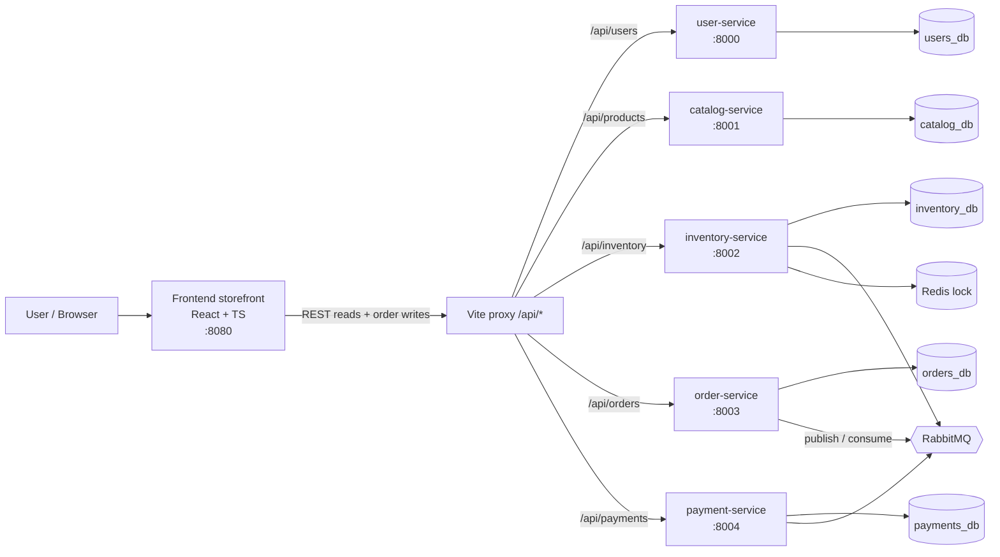
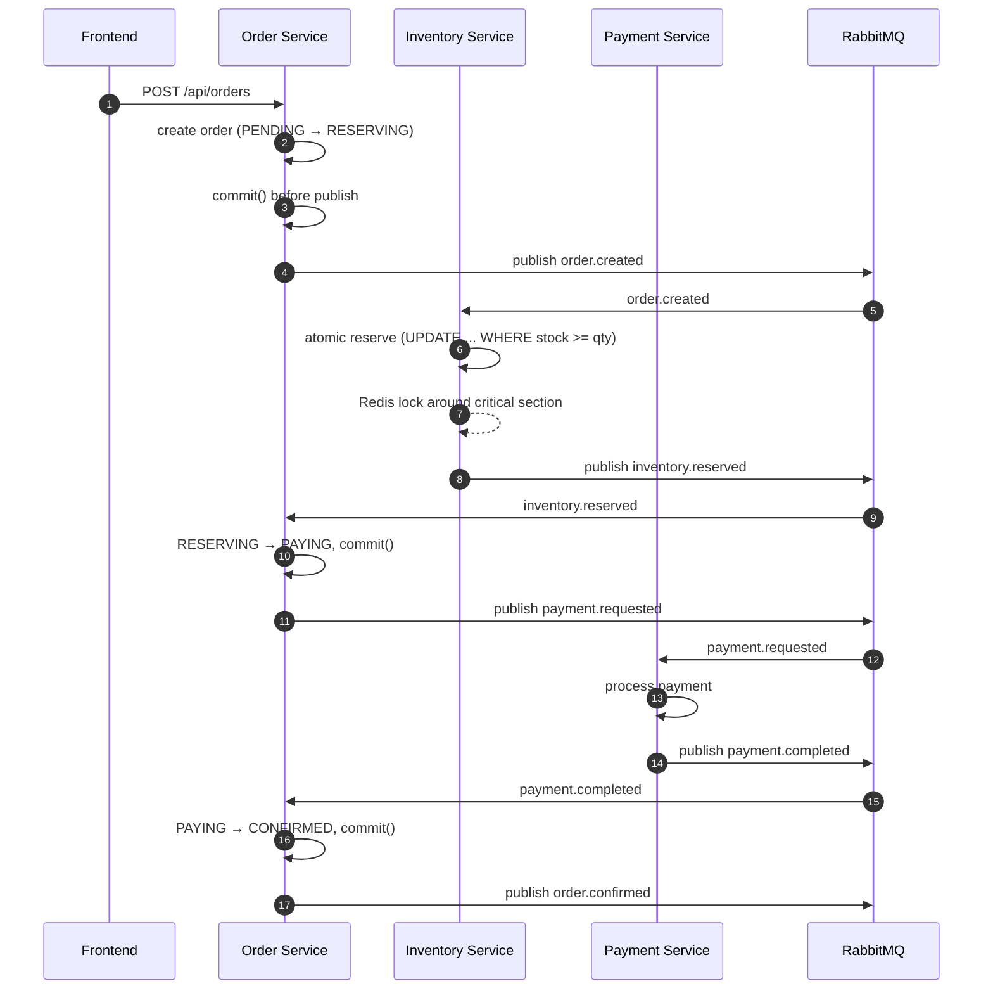
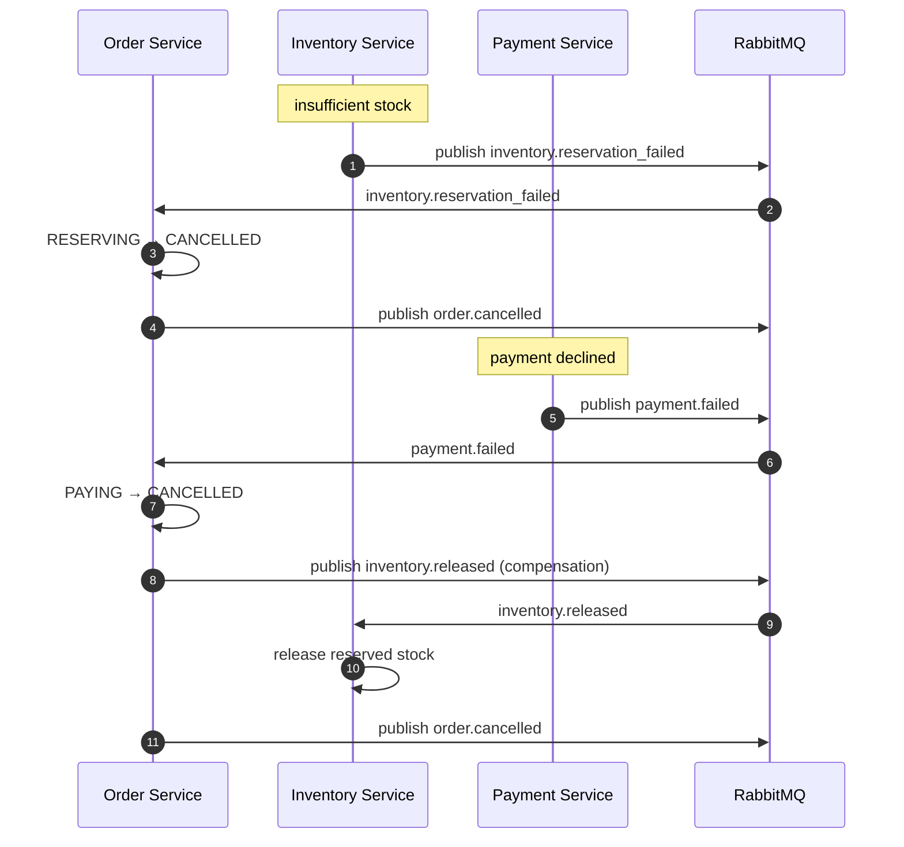
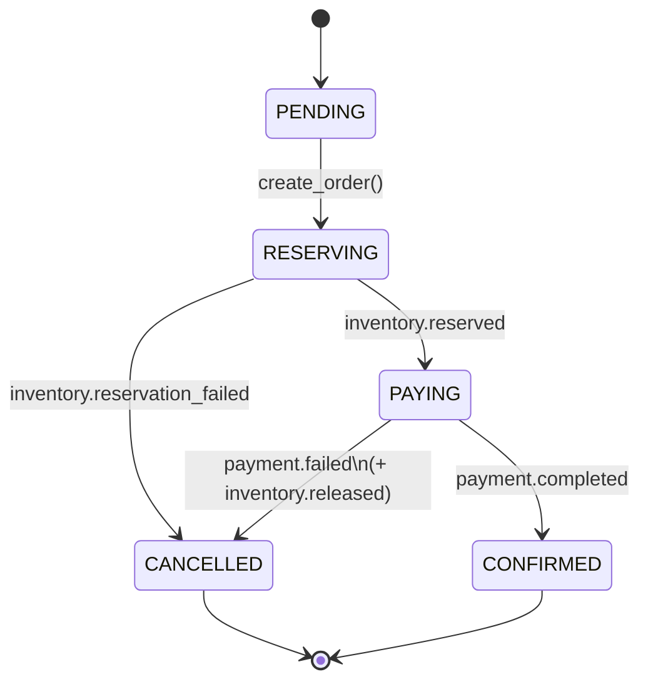
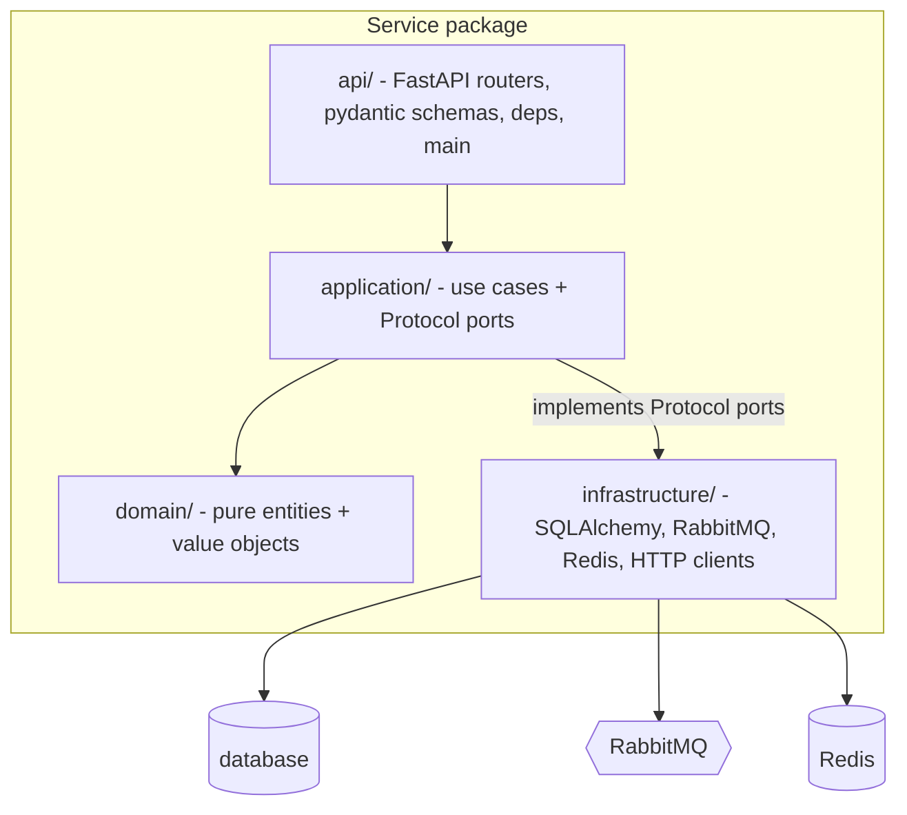
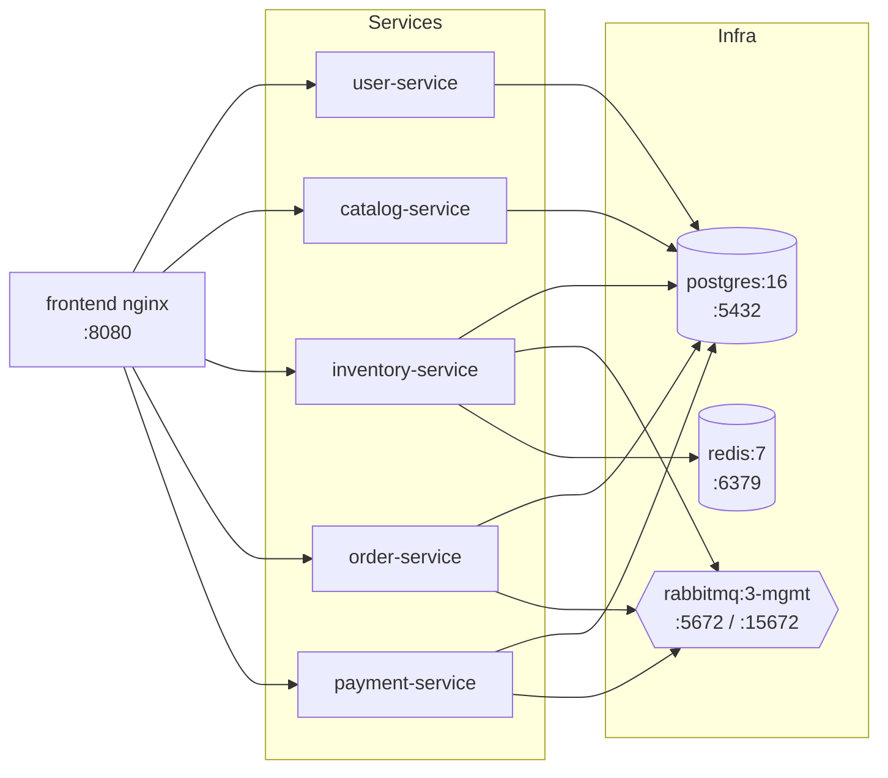

# Architecture

Online-shop microservices — a learning vehicle for system design and distributed-systems
patterns. Backend is Python/FastAPI, frontend is React/TypeScript.

## 1. System context

Five independently deployable services, each owning its own PostgreSQL database. The
frontend reads over synchronous REST and the write path flows through an asynchronous,
orchestration-based saga over RabbitMQ. Redis provides a distributed lock for the
inventory critical section.

## 2. Communication model

**Hybrid:**

- **Synchronous REST** for reads: frontend → catalog / user / inventory / order reads.
- **Async RabbitMQ saga** for the write path (orchestration-based).

Event contracts are the single source of truth in
`backend/shared/src/shop_shared/events.py`. Every event carries a `correlation_id`
(ties it to one saga/order) and an `event_id` (idempotent consumption). Amounts are
integer minor units (cents).

| Direction | Protocol | Used for |
|---|---|---|
| frontend → services | REST (Vite proxy) | catalog, auth, order create, order read, payment read |
| order → catalog | REST (sync client) | price lookup at order creation |
| order → inventory → payment | RabbitMQ | saga orchestration |

## 3. Saga happy path

## 4. Saga compensation (failure paths)

## 5. Order state machine

The Order Service is the saga orchestrator.

## 6. Service internal layout (lite-DDD)

Every service follows the same shape under `backend/services/<svc>/src/<pkg>/`.

Conventions:

- Application depends on `Protocol` ports; infrastructure implements them. Unit tests
  substitute in-memory fakes (`tests/unit/fakes.py`).
- `create_app(settings, ...)` is the app factory; `app.state` holds the engine, session
  factory, and injectable collaborators.
- The `get_session` dependency **commits after the request** — repositories only
  `flush()` writes, and the request-scoped session commits on success.
- Saga handlers **commit before publishing** the next event (a simplification of the
  transactional outbox pattern) so the orchestrator never reads stale state.

## 7. Concurrency & safety

- **Race-condition safety (limited stock):** inventory repository uses an atomic
  conditional `UPDATE ... WHERE stock >= qty RETURNING` — never read-then-write.
- **Distributed lock:** Redis lock wraps the inventory critical section.
- **Idempotency:** consumers dedupe on `event_id`; saga handlers also guard on the
  order's current status as defense in depth.

## 8. Deployment

Local full stack via Docker Compose (`cd backend && docker compose up --build`):

Kubernetes manifests live in `k8s/`. Per-service `Dockerfile`s live under
`backend/services/<svc>/Dockerfile`; the frontend Dockerfile is in
`frontend/storefront/`.

## 9. Ports

| Component | Port |
|---|---|
| user-service | 8000 |
| catalog-service | 8001 |
| inventory-service | 8002 |
| order-service | 8003 |
| payment-service | 8004 |
| frontend | 8080 |
| Postgres | 5432 |
| RabbitMQ (AMQP / mgmt) | 5672 / 15672 |
| Redis | 6379 |
